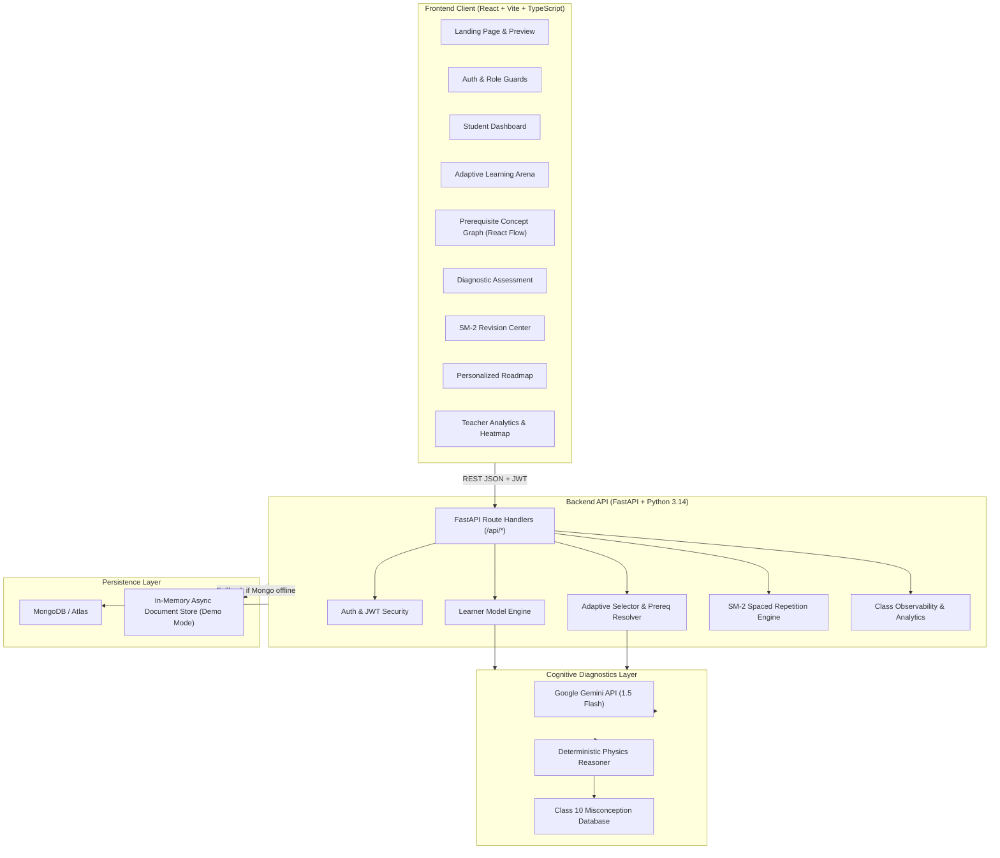

# Learnix AI — Architecture & System Design

## 1. Executive Summary
**Learnix AI** is an intelligent, responsive, adaptive exam-preparation platform tailored for Class 10 Physics (with multi-syllabus modularity). Unlike static educational tools or generic chatbots, Learnix models what every student knows, flags explicit cognitive misconceptions from free-form written explanations, recalculates mastery dynamically, and schedules spaced repetitions.

---

## 2. System Architecture Diagram

---

## 3. Technology Stack

### Frontend
- **Framework**: React 18 with TypeScript and Vite 6
- **Styling**: Tailwind CSS with custom glassmorphism design tokens
- **Motion & Micro-interactions**: Framer Motion
- **Visual Concept Graph**: `@xyflow/react` (React Flow)
- **Data Analytics & Charts**: Recharts (Weekly Velocity, Radar Diagnostics, Heatmaps)
- **Icons**: Lucide React
- **Celebrations**: Canvas Confetti

### Backend
- **Framework**: FastAPI (Asynchronous Python ASGI)
- **Data Validation & Schemas**: Pydantic v2
- **Authentication**: JWT (JSON Web Tokens) with PBKDF2/Bcrypt password hashing
- **Database Driver**: PyMongo with hybrid In-Memory Document Store adapter
- **AI Integration**: Google Generative AI (Gemini 1.5 Flash) with strict JSON output templates

---

## 4. Key Subsystems

### 4.1. The Cognitive Reasoning & Misconception Engine
Rather than relying only on multiple-choice selection, Learnix asks students: *"Explain your reasoning"*.
1. If the student answers correctly but provides nonsense reasoning, their reasoning score is penalized to prevent reward of lucky guesses.
2. If the student answers incorrectly, the reasoning text is matched against the `PHYSICS_MISCONCEPTIONS` database.
3. If an explicit misconception is found (e.g. *current is consumed by resistors* or *longer wire has less resistance*), a targeted remediation card is triggered, and the concept is queued for remediation.

### 4.2. Prerequisite Graph Traversal
The syllabus is organized as a directed acyclic graph (DAG) where nodes represent concepts and edges represent prerequisite dependencies ($A \rightarrow B$). If a student attempts an advanced circuit question but their prerequisite mastery on Ohm's Law or Potential Difference is $<40\%$, the adaptive engine flags the prerequisite first.

### 4.3. Dual Engine Database
To guarantee immediate zero-setup evaluation, Learnix features a dual-mode database engine:
- Connects automatically to live MongoDB if available via `MONGODB_URI`.
- Transparently switches to an in-memory document store pre-seeded with 6 chapters, 26 concepts, 30+ relationships, 40+ questions, and rich student/teacher accounts if MongoDB is unavailable.
